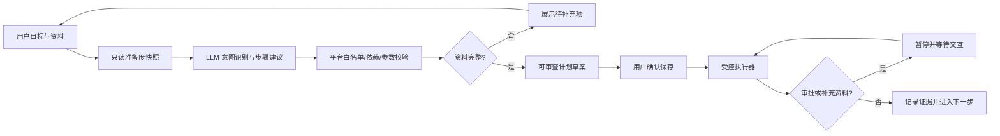

# 学期运营智能体 V2 设计目标与技术落地方案

## 1. 设计目标

学期运营智能体面向不熟悉系统内部模块和实施阶段的学校用户。用户只需要说明业务目标，并按需提供学期、名册文件和业务约束；智能体负责读取当前业务数据、识别意图、判断哪些工作已经完成、生成仍需执行的计划，并在每个安全检查点与用户交互。

一次运行必须满足以下闭环：

1. 用户用自然语言描述目标，不选择“七阶段全流程”等内部实现概念。
2. 系统先生成只读的业务准备度快照，再交给大模型规划。
3. 大模型只能从受控工具目录选择工具，平台按内部依赖图校正顺序并校验参数。
4. 已完成的业务阶段不重复执行；没有被用户目标覆盖的阶段不进入计划。
5. 参数不足时返回待补充资料及原因，不猜测文件 ID、教师、学科、班级或审批人。
6. 用户确认计划后才开始运行。所有正式写入继续经过权限、领域校验和人工审批。
7. 执行过程持续显示当前步骤、完成情况、下一步和证据。用户可以暂停、补充条件或资料、继续、重试和取消。
8. 文件导入、分班、教师分工和排课优先形成候选结果；用户确认后才进入正式写入或发布步骤。
9. 七个开学阶段仅作为内部能力与依赖模型，并在计划生成后用于解释步骤分组，不作为用户输入项。
10. 不启用智能体时，各阶段仍可通过招生、学生、教师、教学、排课等原有业务菜单人工完成。

## 2. 用户交互契约

计划生成入口只收集以下内容：

- 目标描述（必填）；
- 学期、入学年份、知识库（可选）；
- 新生名册等可信受管文件（可选）；
- “先生成候选结果”偏好（默认开启）。

生成结果包含：

- 智能体识别到的目标摘要；
- 当前业务准备度快照；
- 仍需用户补充的资料；
- 计划选择这些步骤的理由；
- 可审查、可编辑的步骤清单及其内部阶段分组。

当存在必填资料缺口时，草案可以展示和继续编辑，但不能直接保存为可执行计划。用户补充资料后重新规划，系统不得用占位值进入正式执行。

## 3. 内部能力与依赖模型

内部仍保留七个阶段：基础数据、新生接入、行政班分班、报到与账号、教师分工、教学班与选课、排课审核发布。工具目录为每个工具声明：

- 风险级别和是否写入；
- 是否强制人工确认、是否要求异人审核；
- 所属阶段和依赖顺序；
- 必需参数及用户可理解的补充说明；
- 重试上限和恢复策略。

平台对模型输出执行确定性处理：工具白名单校验、参数注入、缺失项检测、阶段排序、重复工具去重、候选模式约束及高风险审批提升。模型不能直接访问数据库或绕过领域服务。

## 4. 规划链路

准备度快照按指定学期和入学年份统计学期、行政班、新生状态、学生及账号绑定、教师、教师分工、开课、排课候选和已发布版本。快照用于跳过已完成工作，并作为计划理由的一部分展示。

## 5. 执行期交互

执行器在调用每个工具前合并计划快照、用户附加条件和步骤补充参数，然后做必需参数检查。缺少参数时：

1. 当前步骤进入 `WAITING_INPUT`；
2. 运行实例在安全检查点转为 `PAUSED`；
3. `nextAction` 明确列出需要补充的内容；
4. 用户提交结构化资料或自然语言条件；
5. 平台校验并写入该步骤的参数覆盖，步骤回到 `QUEUED`；
6. 用户点击继续后从该步骤恢复。

已经成功的步骤和正式数据不因重新规划或增加条件被静默回滚。需要改变已生效数据时，必须调用对应领域撤销、变更或版本回滚能力。

## 6. 安全边界

- LLM 负责理解、规划、解释和失败建议；应用服务负责授权、校验、审批和写入。
- 文件 ID 只能来自受管文件上传结果。
- 教师分工必须引用真实工号、学科编码和行政班编码。
- 排课生成先产生候选，提交、异人审核、应用和发布分别保留独立检查点。
- 计划快照冻结后，运行只允许对未开始步骤增加可审计的参数覆盖。
- 每次补充资料、审批、执行和失败均记录事件与操作者。

## 7. 本次重构范围与验收标准

本次重构移除“计划范围/七阶段全流程”输入，新增准备度快照、自动步骤选择、待补充资料返回和执行期步骤参数补充。验收标准：

- 用户只输入“为 2026-2027-1 准备排课”，系统能根据现有数据选择必要步骤，而不是固定生成 17 个工具；
- 已有学期、开课或正式课表能在准备度快照中识别，规划理由可见；
- 未上传名册却要求导入时明确提示上传名册；
- 教师分工缺少映射时返回待补充项，不伪造映射、不以服务端异常结束规划；
- 补齐资料后可保存计划，步骤仍按内部业务依赖排序；
- 执行到缺参数步骤时安全暂停，补充后可继续；
- 写入、审批、异人审核和发布的现有安全边界不降低。
